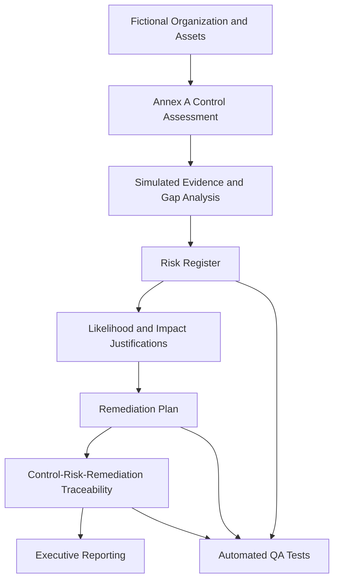

# ISO 27001:2022 GRC Gap Assessment & Risk Management

A simulated enterprise cybersecurity governance, risk, and compliance
project demonstrating security control assessment, risk analysis,
remediation planning, traceability, and automated reporting.

## Project Overview

This project evaluates **Northstar Digital Solutions**, a fictional
50-employee organization operating a hybrid environment with AWS,
Microsoft 365, and Windows/macOS endpoints.

The assessment focuses on 10 selected ISO/IEC 27001:2022 Annex A
controls and demonstrates how security gaps can be documented,
prioritized, and connected to remediation activities.

**Disclaimer:** This is an educational simulation, not a real
organizational audit or ISO 27001 certification assessment.

## Business Problem

Organizations need a structured way to understand security gaps,
evaluate their potential business impact, assign risk ownership,
and track remediation.

This project demonstrates an integrated GRC workflow that connects
control assessment, evidence, risk analysis, and risk treatment.

## Architecture

## Assessment Results

| Metric | Result |
|---|---:|
| Selected Annex A controls assessed | 10 |
| Controls partially met | 9 |
| Controls not met | 1 |
| Simulated risk scenarios | 21 |
| Critical risks | 8 |
| High risks | 13 |
| Planned remediation actions | 21 |
| Automated integrity tests | 12 |

All findings are hypothetical and limited to the selected controls.

## Selected Annex A Controls

| Control ID | Control Topic |
|---|---|
| A.5.1 | Policies for information security |
| A.5.9 | Inventory of information and other associated assets |
| A.5.15 | Access control |
| A.5.16 | Identity management |
| A.5.17 | Authentication information |
| A.5.24 | Incident management planning and preparation |
| A.8.5 | Secure authentication |
| A.8.9 | Configuration management |
| A.8.13 | Information backup |
| A.8.15 | Logging |

## Risk Assessment Methodology

The assessment uses a qualitative 5x5 risk matrix.

**Risk Score = Likelihood x Impact**

| Score | Severity |
|---|---|
| 1-5 | Low |
| 6-11 | Medium |
| 12-19 | High |
| 20-25 | Critical |

These are project-defined thresholds, not ISO-prescribed values.

Each risk includes individual likelihood and impact justifications.

See [Risk Assessment Methodology](docs/risk-assessment-methodology.md).

## Risk Treatment and Remediation

Each simulated risk is connected to a planned remediation action
with a responsible owner, priority, target deadline, completion
criteria, and status.

No remediation action is represented as completed.

See [Remediation Planning Assumptions](docs/remediation-planning-assumptions.md).

## Reporting

The project produces an executive risk report and a consolidated
control-risk-remediation traceability matrix.

- [Executive Risk Report](reports/executive-risk-report.md)
- [Control-Risk Traceability Matrix](reports/control-risk-traceability.csv)

The executive report includes a proposed 30/60/90-day roadmap.

## Automated Quality Assurance

Python's built-in unittest framework validates dataset integrity,
risk calculations, evidence references, control coverage,
remediation relationships, and traceability consistency.

A negative test confirmed that deliberately corrupted risk scores
are detected by the test suite.

### Run Tests

    python3 -m unittest discover -s tests -v

### Regenerate Executive Report

    python3 scripts/generate_executive_report.py

### Regenerate README

    python3 scripts/generate_readme.py

## Technology Stack

- Python 3
- Python unittest
- CSV and Markdown
- Git and GitHub
- ISO/IEC 27001:2022 Annex A
- Qualitative risk assessment

## Project Structure

    iso27001-grc-gap-assessment/
    ├── README.md
    ├── scope/
    ├── asset-inventory/
    ├── control-assessment/
    ├── evidence/
    ├── risk-register/
    ├── remediation/
    ├── reports/
    ├── docs/
    ├── scripts/
    └── tests/

## Assessment Limitations

- Fictional organization and simulated evidence
- No production systems independently assessed
- Only 10 selected Annex A controls evaluated
- ISO 27001 clauses 4-10 not comprehensively assessed
- No formal Statement of Applicability
- No certification or compliance conclusion
- No verified remediation completion
- No residual risk assessment

## Skills Demonstrated

- ISO 27001 control gap assessment
- Governance, Risk, and Compliance (GRC)
- Cybersecurity risk assessment
- Risk scoring and prioritization
- Risk treatment and remediation planning
- Evidence documentation
- Control-risk-remediation traceability
- Executive cybersecurity reporting
- Python security automation
- Automated data integrity testing

## Intended Use

This repository is a cybersecurity portfolio case study
demonstrating a selected-control GRC assessment workflow.
